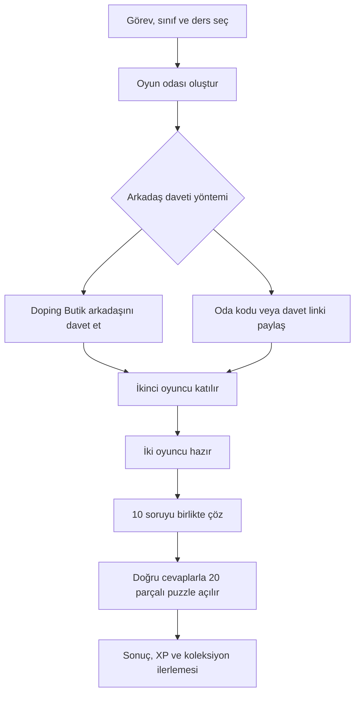

# Doping Keşif — Backend Technical Design & Documentation

**Birlikte Çöz, Birlikte Keşfet!**

Doping Keşif, Doping Hafıza içerisinde tasarlanan, iki öğrencinin birlikte sorular çözerek ortak bir puzzle görevinde ilerlemesini amaçlayan **iş birlikçi eğitsel oyun** projesidir.

Bu repository, projenin **kodlama öncesi backend teknik tasarımını ve geliştirme planını** içerir. Çalışan bir uygulama, üretime hazır API veya tamamlanmış bir entegrasyon deposu değildir.

## Proje Hakkında

Öğrenciler bir görev, sınıf ve ders seçerek iki kişilik oyun oturumu oluşturur. Aynı Doping Butik grubundaki bir arkadaşlarını davet edebilir veya **oda kodu / davet bağlantısı** üzerinden bir arkadaşlarının katılmasını sağlayabilirler. İki oyuncu aynı **10 soruyu** çözer; her doğru cevap ortak **20 parçalı puzzle** görselinden bir parça açar. Oyun sonunda sonuçlar, XP ve kişisel koleksiyon ilerlemesi görüntülenir.

Temel amaç öğrencilerin birbirleriyle yarışması değil, **ortak bir hedefe ulaşmasıdır**.


## Öne Çıkan Özellikler

- İki kişilik, eş zamanlı soru çözme deneyimi
- Doping Butik grubundan arkadaş daveti
- Oda oluşturma, kodla katılma ve davet linki paylaşma tasarımı
- 10 soruluk oturum ve 20 parçalı ortak puzzle
- Görevler, kişisel koleksiyon ve XP sistemi
- Yetkilendirme, oturum güvenliği ve bağlantı kopması senaryoları
- REST API, WebSocket olayları ve PostgreSQL veri modeli

## Planlanan Teknolojiler

| Katman | Teknoloji / yaklaşım |
|---|---|
| Frontend | React, TypeScript, Tailwind CSS |
| Backend | Java 21, Spring Boot, katmanlı mimari |
| Veritabanı | PostgreSQL, Flyway |
| Güvenlik | Spring Security, JWT (entegrasyona göre kesinleşecek) |
| API dokümantasyonu | OpenAPI / Swagger |
| Gerçek zamanlı iletişim | WebSocket / STOMP |
| Test | JUnit, Testcontainers |
| Geliştirme ortamı | Docker (öneri) |

**Not:** Bunlar teknik tasarımda önerilen teknolojilerdir; bu depoda çalışan uygulama kodu bulunmamaktadır.

## Sistem Akışı



## Teknik Dokümantasyon

Tüm belgeler `docs/` klasöründe, ayrı Markdown dosyaları olarak tutulmaktadır.

| Belge | Dosya |
|---|---|
| [Doküman durumu ve kapsam](docs/00-document-status.md) | `00-document-status.md` |
| [Proje gereksinimleri](docs/01-project-scope-and-requirements.md) | `01-project-scope-and-requirements.md` |
| [Oyun akışı ve durum makineleri](docs/02-game-flow-and-state-machines.md) | `02-game-flow-and-state-machines.md` |
| [Sistem mimarisi ve entegrasyonlar](docs/03-system-architecture-and-integrations.md) | `03-system-architecture-and-integrations.md` |
| [PostgreSQL veritabanı tasarımı](docs/04-postgresql-database-schema.md) | `04-postgresql-database-schema.md` |
| [ER diyagramı](docs/05-entity-relationship-diagram.md) | `05-entity-relationship-diagram.md` |
| [Java Entity, DTO ve servis modelleri](docs/06-java-domain-models-and-dtos.md) | `06-java-domain-models-and-dtos.md` |
| [REST API sözleşmeleri](docs/07-rest-api-specification.md) | `07-rest-api-specification.md` |
| [WebSocket gerçek zamanlı iletişim](docs/08-websocket-realtime-protocol.md) | `08-websocket-realtime-protocol.md` |
| [Oyun motoru ve transaction yönetimi](docs/09-game-engine-and-transactions.md) | `09-game-engine-and-transactions.md` |
| [JWT, yetkilendirme ve güvenlik](docs/10-security-jwt-and-privacy.md) | `10-security-jwt-and-privacy.md` |
| [Test stratejisi ve izlenebilirlik](docs/11-testing-and-observability.md) | `11-testing-and-observability.md` |
| [Flyway migration ve geliştirme planı](docs/12-migrations-and-development-plan.md) | `12-migrations-and-development-plan.md` |
| [Örnek PostgreSQL DDL](docs/13-example-postgresql-ddl.md) | `13-example-postgresql-ddl.md` |
| [WebSocket JSON örnekleri](docs/14-websocket-json-examples.md) | `14-websocket-json-examples.md` |
| [Codex geliştirme görevleri](docs/15-codex-implementation-guide.md) | `15-codex-implementation-guide.md` |
| [Oda kodu ve davet linki sistemi](docs/16-rooms-codes-and-invite-links.md) | `16-rooms-codes-and-invite-links.md` |
| [Oda REST API ve WebSocket sözleşmeleri](docs/17-room-api-and-websocket-contracts.md) | `17-room-api-and-websocket-contracts.md` |
| [Frontend ekran akışı ve entegrasyon](docs/18-ui-flow-and-integration.md) | `18-ui-flow-and-integration.md` |
| [Oda SQL tasarımı ve ER diyagramı](docs/19-room-sql-and-er-diagram.md) | `19-room-sql-and-er-diagram.md` |
| [Açık teknik kararlar ve değişiklikler](docs/20-product-decisions-and-change-log.md) | `20-product-decisions-and-change-log.md` |

### Önerilen okuma sırası

Önce **gereksinimler → sistem mimarisi → PostgreSQL şeması → ER diyagramı** bölümlerini okuyun. Ardından **Java modelleri → REST API → WebSocket → güvenlik** dokümanlarına geçin. Oda kodu ve linkle katılımın güncel kuralları için **16–20 numaralı belgeler** esas alınmalıdır.

## Veritabanı ve Backend Kapsamı

Teknik tasarımda **17 çekirdek tablo + 2 oda yönetimi tablosu** olmak üzere toplam **19 tablo önerisi** yer almaktadır. Tablo sözlüğü, PK/FK ilişkileri, indeks önerileri ve örnek SQL DDL belgelenmiştir. Bu şema, ekip onayı ve mevcut Doping Hafıza altyapısıyla uyum değerlendirmesi gerektirir.

Backend tasarımında Java Entity/DTO katmanları, Spring Security/JWT, OpenAPI/Swagger, WebSocket/STOMP mesajlaşması, oyun oturumu yönetimi, eşzamanlı cevap değerlendirme ve test senaryoları ele alınmıştır.

## Geliştirme Durumu

- [x] Proje kapsamı ve oyun akışı dokümantasyonu
- [x] İlk PostgreSQL veri modeli ve ER diyagramı taslağı
- [x] REST API ve WebSocket sözleşme taslakları
- [x] Oda kodu / davet bağlantısı teknik tasarımı
- [x] Geliştirme aşamaları ve Codex görev listesi
- [ ] Açık ürün ve entegrasyon kararlarının ekipçe onaylanması
- [ ] Nihai veritabanı şeması ve API sözleşmelerinin kesinleştirilmesi
- [ ] Spring Boot backend geliştirmesi
- [ ] Frontend entegrasyonu ve uçtan uca testler

## Repository Yapısı

```text
Doping-Kesif-Backend-Documentation/
├── README.md
├── .gitignore
└── docs/
    ├── 00-document-status.md
    ├── 01-project-scope-and-requirements.md
    ├── ...
    ├── 16-rooms-codes-and-invite-links.md
    ├── 17-room-api-and-websocket-contracts.md
    ├── 18-ui-flow-and-integration.md
    ├── 19-room-sql-and-er-diagram.md
    └── 20-product-decisions-and-change-log.md
```

**Doping Keşif** · Backend Teknik Tasarım ve Geliştirme Dokümantasyonu
