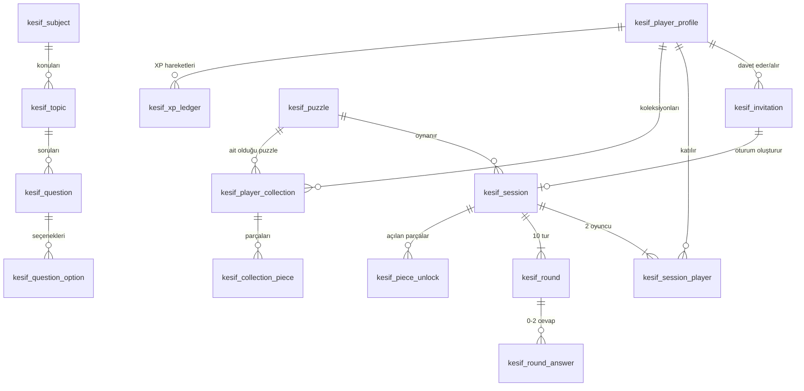
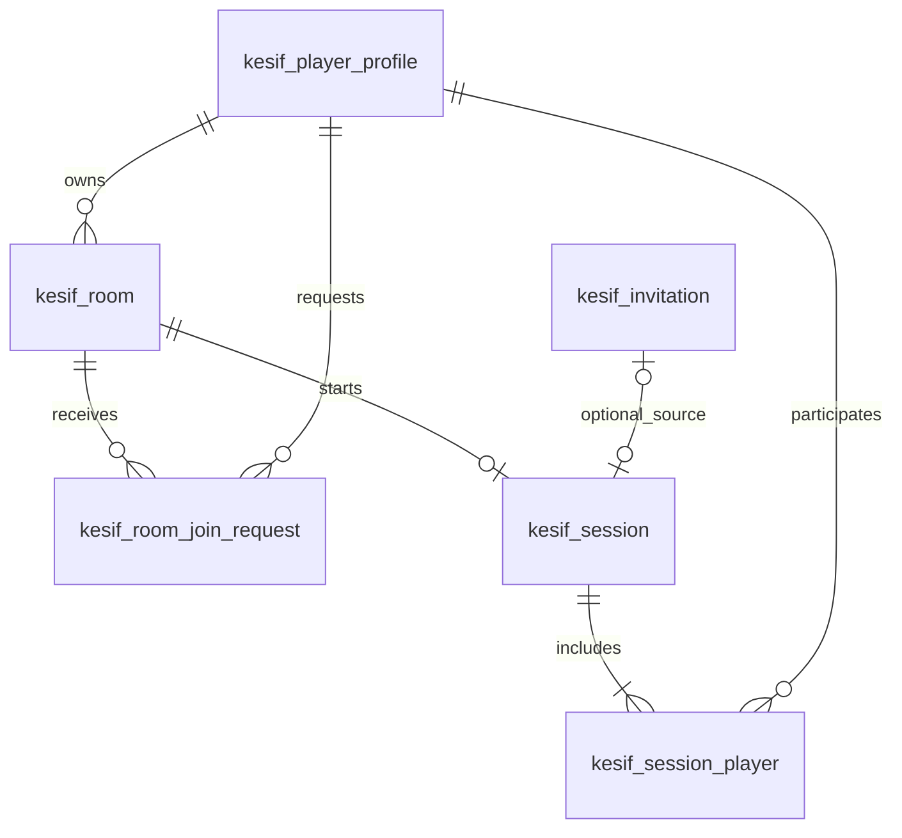

# 5. ER diyagramı ve ilişkiler

> kesif_player_profile 1 ── N kesif_invitation (inviter/invitee)
>
> kesif_invitation 1 ── 0..1 kesif_session
>
> kesif_session 1 ── 2 kesif_session_player N ── 1 kesif_player_profile
>
> kesif_subject 1 ── N kesif_topic 1 ── N kesif_question 1 ── N kesif_question_option
>
> kesif_puzzle 1 ── N kesif_session
>
> kesif_session 1 ── 10 kesif_round 1 ── 0..2 kesif_round_answer
>
> kesif_session 1 ── 0..20 kesif_piece_unlock
>
> kesif_player_profile 1 ── N kesif_player_collection N ── 1 kesif_puzzle
>
> kesif_player_collection 1 ── 0..20 kesif_collection_piece
>
> kesif_player_profile 1 ── N kesif_xp_ledger

Fiziksel ERD’de session_player tablosu oyuncu-maç N:N ilişkisini çözer. Round_answer hem round hem player’a bağlıdır; cevabı veren oyuncunun o session’a katıldığının servis katmanında ayrıca kontrol edilmesi gerekir. Invitation → Session birebir ve opsiyonel ilişki olarak tasarlanır.

## 5.1 Görsel ER ilişki diyagramı (Mermaid)

Aşağıdaki şema, yukarıdaki ilişkilerin görsel özetidir. Kolon tanımları için 4. bölüme bakınız.

## 5.2 Mermaidsiz şema okuma

İlişkilerde 1:N = bir kayıttan çok kayıt; 1:2 = bir maça tam iki katılımcı (uygulama invariant’ı); 1:10 = maçta on tur; 0..2 = her turda en fazla iki yanıt; 0..20 = en fazla yirmi puzzle parçası. Bu sayılar PostgreSQL üzerinde yalnız FK ile değil, transaction ve testlerle korunur.

## 5.3 Yeni oda ilişkileri

Yeni iki tablo dahil tam genişletme: [19 — SQL/ER](19-room-sql-and-er-diagram.md).
