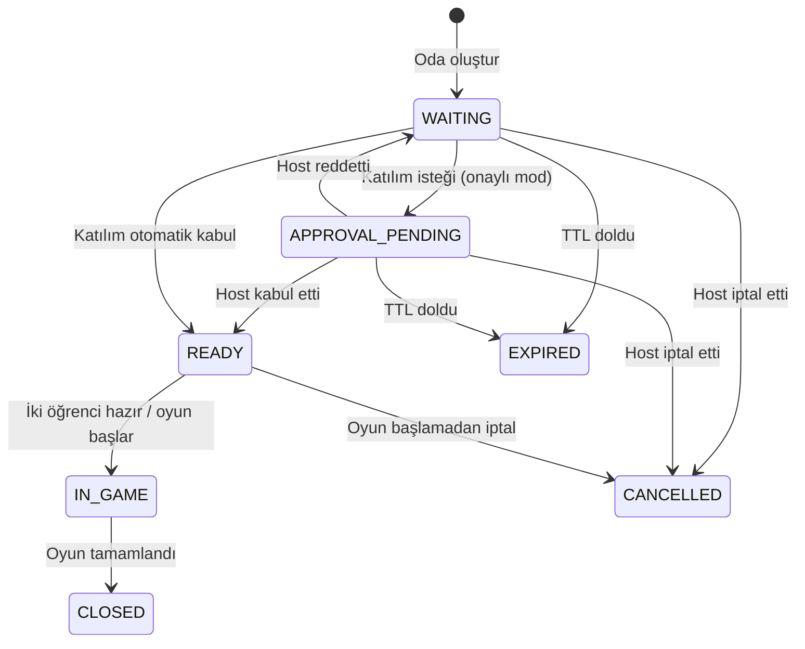

# 16. Oda, Kod ve Davet Linki — Domain ve Veritabanı Tasarımı

> **Durum:** Yeni ürün isteğine dayalı tasarım. Oda kodu/link ile katılım **ürün gereksinimidir**; kod uzunluğu, grup dışından katılım ve host onayı gibi ayrıntılar **öneri / açık karar**dır.

## 16.1 Neden yeni oda modeli?

Önceki akış yalnızca Doping Butik grubundaki bir arkadaşın davet edilmesini destekliyordu. Güncel Doping Keşif ekranlarında **Arkadaş Seç (Doping Butik)** ve **Kod / Davet Linki ile Katıl** seçenekleri vardır. Kod/link yolunda karşı tarafın aynı Butik grubunda olması zorunlu olmayabilir; bu yetki A13 kararıyla netleştirilmelidir. Rastgele eşleştirme yoktur.

- **Oda (Room):** İki kişilik oyunun henüz başlamamış bekleme alanı, paylaşım bilgileri ve erişim kuralları.
- **Davet (Invitation):** Butik grubundan belirli bir kullanıcıya gönderilen hedefli davet.
- **Katılım talebi (JoinRequest):** Oda kodu veya linkiyle odaya erişmek isteyen öğrencinin isteği.
- **Oyun oturumu (Session):** Her iki oyuncu hazır olduktan sonra oluşturulan, 10 soruluk gerçek oyun.

`Room` ve `Session` aynı nesne değildir. İptal edilmiş veya süresi dolmuş bir oda oyun oturumu üretmeyebilir.

## 16.2 İki giriş yöntemi

| Yöntem | Akış | Doğrulama | Olası kısıt |
|---|---|---|---|
| **Butik arkadaşını seç** | Grup arkadaşını seç → davet → kabul → lobi | İki kullanıcı aynı aktif Butik grubunda | Kesin: grup dışı doğrudan arkadaş daveti yok |
| **Kod/link ile oda** | Görev ayarları → oda oluştur → kod/link paylaş → diğer kullanıcı kodu/linki açar → lobi | İki hesap da giriş yapmış, oda açık, erişim geçerli, 2 kişilik sınır | Grup dışı katılım A13; host onayı A14 |

**Önerilen varsayılan MVP politikası:** Kod/link ile başka Butik grubundan gelen oturum açmış öğrenci **oda sahibinin onayıyla** katılabilir. Bu, önceki “yalnız aynı grup” kuralından **bilinçli bir kapsam değişikliğidir** ve ürün ekibinden onay gerektirir.

## 16.3 Oda yaşam döngüsü

`READY` oda statüsü ile oyuncuların `ready` bayrakları farklıdır. `IN_GAME` durumunda yeni kullanıcı alınmaz.

## 16.4 PostgreSQL: `kesif_room`

| Kolon | PostgreSQL tipi | Kısıt | Amaç |
|---|---|---|---|
| `id` | uuid | PK | Oda ID |
| `host_player_id` | uuid | FK → `kesif_player_profile.id`, NOT NULL | Odayı oluşturan |
| `group_external_id` | varchar(128) | NULL | Butik akışında referans; kod/link yolunda opsiyonel |
| `puzzle_id` | uuid | FK → `kesif_puzzle.id`, NOT NULL | Seçilen görev |
| `topic_id` | uuid | FK → `kesif_topic.id`, NOT NULL | Konu / ders / sınıf |
| `status` | varchar(24) | NOT NULL, CHECK | WAITING, APPROVAL_PENDING, READY, IN_GAME, CLOSED, CANCELLED, EXPIRED |
| `join_code_hash` | varchar(128) | UNIQUE, NOT NULL | Kodun HMAC-SHA256 çıktısı (örnek) |
| `invite_token_hash` | varchar(128) | UNIQUE, NOT NULL | Linkin rastgele token'ının HMAC-SHA256 çıktısı |
| `join_policy` | varchar(24) | NOT NULL | HOST_APPROVAL veya AUTO_ACCEPT |
| `max_players` | smallint | NOT NULL DEFAULT 2, CHECK (=2) | İki kişilik oyun |
| `expires_at` | timestamptz | NOT NULL | Katılım süresi |
| `version` | bigint | NOT NULL DEFAULT 0 | Optimistic locking |
| `created_at` / `updated_at` | timestamptz | NOT NULL | Audit |
| `closed_at` | timestamptz | NULL | Kapanış |

**Not:** Kodu yalnız HMAC hash olarak saklamak, oda sahibine kodu tekrar göstermeyi zorlaştırır. MVP'de kod **yalnız oluşturma yanıtında** dönebilir; tekrar paylaşım için yeni kod üretilir. Alternatif olarak şifrelenmiş değer ayrı bir alanda saklanabilir; bu karar güvenlik ekibiyle verilmeli.

## 16.5 PostgreSQL: `kesif_room_join_request`

| Kolon | PostgreSQL tipi | Kısıt | Amaç |
|---|---|---|---|
| `id` | uuid | PK | Katılım talebi |
| `room_id` | uuid | FK → `kesif_room.id`, NOT NULL | Hedef oda |
| `requester_player_id` | uuid | FK → `kesif_player_profile.id`, NOT NULL | Talep eden |
| `method` | varchar(16) | CHECK IN (`CODE`, `LINK`, `BOUTIQUE`) | Katılım kaynağı |
| `status` | varchar(20) | CHECK IN (`PENDING`, `APPROVED`, `REJECTED`, `CANCELLED`, `EXPIRED`) | Talep durumu |
| `reviewed_by_player_id` | uuid | FK → player, NULL | Onaylayan/reddeden |
| `reviewed_at` | timestamptz | NULL | İşlem zamanı |
| `created_at` / `updated_at` | timestamptz | NOT NULL | Audit |

**Tekrarlama:** Aynı öğrenci aynı odaya art arda başvursa bile aktif `PENDING/APPROVED` kayıt tek olmalı; kısmi unique indeks önerilir. Ret sonrası yeniden denemeye izin politikası ayrıca belirlenir.

## 16.6 Mevcut tablolarla bağlantı

- `kesif_session.room_id` yeni FK; **`UNIQUE(room_id)`** ile bir odadan en fazla bir oyun.
- `kesif_session.invitation_id` NULL yapılır; yalnız Butik davetiyle oluşan oturumlarda dolu.
- `kesif_session_player` iki oyuncuyu temsil etmeye devam eder; davet linki üçüncü oyuncu oluşturamaz.
- `kesif_invitation` sadece doğrudan Butik arkadaş daveti için kullanılır.
- `kesif_room_join_request` oyunun cevabı/puanı değildir; sadece katılım yetkilendirmesini temsil eder.

## 16.7 Kod ve link güvenliği

1. **Öneri:** İnsan tarafından okunabilir 6–8 karakterli kod, karıştırılabilir karakterleri dışlayan bir alfabe; gerçek uzunluk A16.
2. **Öneri:** Linkte en az 128 bit CSPRNG ile üretilmiş, URL-safe rastgele token. Örnek biçim: `https://<onayli-origin>/kesif/katil?token=<opaque-token>`; **gerçek alan adı/rota onaylanmadı**.
3. Kod ve link token'ları JWT değildir; **login zorunludur**.
4. Token/kod HMAC hash ile aranır; eşleşme sabit zamanlı karşılaştırma veya indeksli HMAC eşleştirme ile yapılır.
5. IP/hesap bazlı deneme limiti; bot/brute-force engeli; süresi dolan kodlar reddedilir.
6. Oda sahibi kodu yenilerse önceki kod/link iptal edilir; yenileme politikası A16.
7. Kod ve token loglarda, analytics payload'ında veya error response'da gösterilmez.
8. Host onayı varsa onay gelmeden oyun katılımcısı sayılmaz.

## 16.8 Kabul kriterleri

- Kod veya link ile girişte kimlik doğrulaması istenir.
- Aynı kod/link ile üçüncü oyuncu odaya katılamaz.
- Butik davetindeki aynı grup kontrolü korunur; kod/link politikası ayrıca uygulanır.
- Oda sahibi ve katılımcı yetkili oturum üzerinden lobby güncellemesi alır.
- Aynı anda gelen katılım istekleri kapasiteyi aşmaz.
- Oda TTL, iptal, host reddi ve reconnect durumları test edilir.
