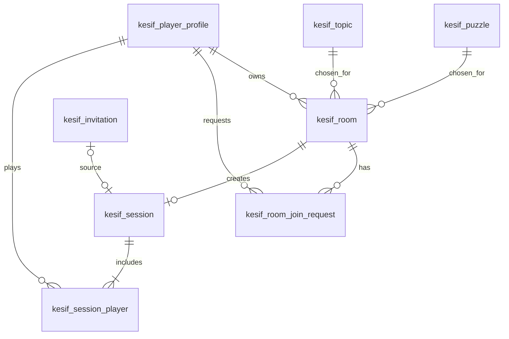

# 19. Oda SQL DDL Taslağı ve ER Diyagramı

> Bu SQL **tasarım örneğidir**, hazır production migration değildir. Önce `kesif_player_profile`, `kesif_puzzle`, `kesif_topic`, `kesif_session` şemalarının gerçek kolon adlarını ve veri tiplerini doğrulayın.

## 19.1 ER diyagramı



## 19.2 PostgreSQL / Flyway örneği

```sql
-- ÖNERİ: V7__kesif_rooms_and_join_requests.sql
CREATE TABLE kesif.kesif_room (
    id uuid PRIMARY KEY,
    host_player_id uuid NOT NULL REFERENCES kesif.kesif_player_profile(id),
    group_external_id varchar(128),
    puzzle_id uuid NOT NULL REFERENCES kesif.kesif_puzzle(id),
    topic_id uuid NOT NULL REFERENCES kesif.kesif_topic(id),
    status varchar(24) NOT NULL DEFAULT 'WAITING',
    join_code_hash varchar(128) NOT NULL UNIQUE,
    invite_token_hash varchar(128) NOT NULL UNIQUE,
    join_policy varchar(24) NOT NULL DEFAULT 'HOST_APPROVAL',
    max_players smallint NOT NULL DEFAULT 2 CHECK (max_players = 2),
    expires_at timestamptz NOT NULL,
    version bigint NOT NULL DEFAULT 0,
    created_at timestamptz NOT NULL DEFAULT now(),
    updated_at timestamptz NOT NULL DEFAULT now(),
    closed_at timestamptz,
    CONSTRAINT chk_kesif_room_status CHECK
      (status IN ('WAITING','APPROVAL_PENDING','READY','IN_GAME','CLOSED','CANCELLED','EXPIRED')),
    CONSTRAINT chk_kesif_room_join_policy CHECK
      (join_policy IN ('HOST_APPROVAL','AUTO_ACCEPT'))
);

CREATE INDEX idx_kesif_room_host_status
  ON kesif.kesif_room(host_player_id, status);
CREATE INDEX idx_kesif_room_expires
  ON kesif.kesif_room(expires_at)
  WHERE status IN ('WAITING','APPROVAL_PENDING','READY');

CREATE TABLE kesif.kesif_room_join_request (
    id uuid PRIMARY KEY,
    room_id uuid NOT NULL REFERENCES kesif.kesif_room(id),
    requester_player_id uuid NOT NULL REFERENCES kesif.kesif_player_profile(id),
    method varchar(16) NOT NULL,
    status varchar(20) NOT NULL DEFAULT 'PENDING',
    reviewed_by_player_id uuid REFERENCES kesif.kesif_player_profile(id),
    reviewed_at timestamptz,
    created_at timestamptz NOT NULL DEFAULT now(),
    updated_at timestamptz NOT NULL DEFAULT now(),
    CONSTRAINT chk_kesif_room_join_method CHECK (method IN ('CODE','LINK','BOUTIQUE')),
    CONSTRAINT chk_kesif_room_join_status CHECK
      (status IN ('PENDING','APPROVED','REJECTED','CANCELLED','EXPIRED'))
);

CREATE UNIQUE INDEX uq_kesif_room_active_request
  ON kesif.kesif_room_join_request(room_id, requester_player_id)
  WHERE status IN ('PENDING','APPROVED');

CREATE INDEX idx_kesif_room_join_room_status
  ON kesif.kesif_room_join_request(room_id, status);

-- Mevcut session tablosunun ilk migrasyonuna göre uyarlayın.
ALTER TABLE kesif.kesif_session
  ADD COLUMN room_id uuid REFERENCES kesif.kesif_room(id);
CREATE UNIQUE INDEX uq_kesif_session_room
  ON kesif.kesif_session(room_id) WHERE room_id IS NOT NULL;

-- Mevcut invitation_id NOT NULL ise, yeni akışta nullable olmalıdır.
ALTER TABLE kesif.kesif_session
  ALTER COLUMN invitation_id DROP NOT NULL;
```

**Geçiş uyarısı:** Mevcut veri varsa `room_id` ilk etapta nullable tutulur, eski oturumlara oda backfill yapılır, doğrulamadan sonra yeni kayıtlar için NOT NULL politikası uygulanır. Veritabanında tablo adları `battle_*` ise otomatik `kesif_*` yeniden adlandırma yapmayın; ayrıca geçiş planı gerekir.

## 19.3 Kritik veri bütünlüğü kuralları

- İki oyuncu limiti yalnız `max_players=2` CHECK ile korunmaz; join transaction'ında oda satırı kilitlenmeli ve mevcut katılımcılar sayılmalıdır.
- `session.room_id` tekil olmalı; aynı oda iki maç başlatmamalı.
- `join_code_hash` ve `invite_token_hash` değerleri kriptografik olarak güçlü üretilmeli; ham token DB'de bulunmamalı.
- `JOIN_REQUEST` kaydı **onaylı katılımcı** ile aynı şey değildir. İki kişilik koltuk sayımı yalnız onaylı üyelikten yapılmalıdır.
- Kod/link ile katılım sonrasında oda üyeliğini kalıcı temsil etmek için ayrı `kesif_room_member` tablosu da düşünülebilir; MVP'de onaylı join request + host yeterli olabilir. Bu seçenek veri modeli onayı sırasında karara bağlanmalıdır.
